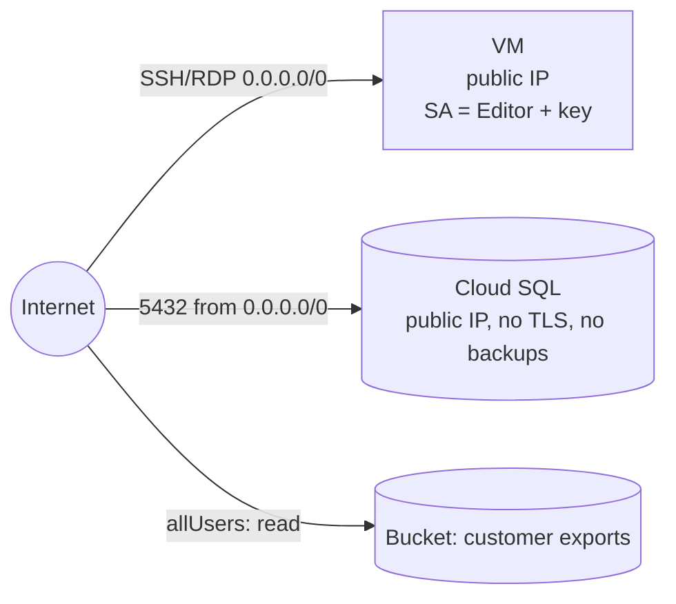
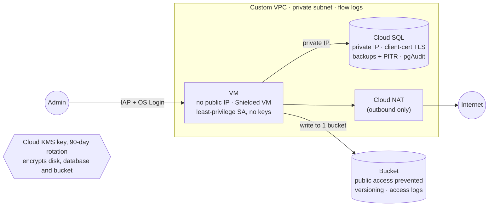

# Cloud Security: Hardening a Misconfigured Google Cloud Deployment

[](https://github.com/pulemoliserr/cloud-security-gcp/actions/workflows/iac-security.yml)

Part of my cybersecurity portfolio: [project write-up](https://pulemolise.net/cybersecurity/cloud-security-gcp/) · [pulemolise.net](https://pulemolise.net)

Infrastructure-as-code project. I wrote a small **"customer portal" on Google Cloud** (web VM, Cloud SQL database, storage bucket) twice: first with **eight common misconfigurations**, then **hardened**. Both versions are scanned with **Checkov** plus three **custom policies** I wrote, and a CI pipeline blocks any change that makes the secure version fail.

| | Insecure | Secure |
|---|---:|---:|
| Failed security checks | **31** | **0** |
| Passed checks | 23 | 74 |
| Accepted exceptions (documented) | 0 | 1 |

Full results: [reports/summary.md](reports/summary.md)

**Skills shown:** Google Cloud IAM, VPC networking and firewall design, Cloud KMS, Cloud SQL security, Cloud Audit Logs, Terraform, policy-as-code, CI/CD security scanning. This builds on the *Google Cloud Cybersecurity Certificate*.

## Architecture

**Before:** everything is reachable from the internet.



**After:** no public endpoints, and admin access only through Identity-Aware Proxy.



## The eight misconfigurations and their fixes

| # | Misconfiguration (insecure) | Why it matters | Fix (secure) |
|---|---|---|---|
| **M1** | Auto-mode VPC: a subnet in every region, no flow logs | Bigger attack surface; no network evidence for investigations | Custom-mode VPC, one subnet, **VPC Flow Logs**, Private Google Access |
| **M2** | Firewall allows **SSH and RDP from 0.0.0.0/0**, no logging | Internet-wide brute force and exploitation of remote-access services | SSH only from **Identity-Aware Proxy** (`35.235.240.0/20`) to tagged VMs, no RDP, **firewall logging** |
| **M3** | App service account has project-wide **Editor** | One compromised VM can change almost anything in the project | Only `logWriter`, `metricWriter` and `cloudsql.client`, plus write access to **one** bucket |
| **M4** | Downloadable **service account key** | Long-lived credential that leaks through code, laptops and tickets | No keys: the VM uses its attached identity (short-lived tokens) |
| **M5** | VM with public IP, serial port on, project SSH keys allowed, no Shielded VM | Directly reachable; weak control over who can log in | No external IP (egress via **Cloud NAT**), **OS Login**, project keys blocked, serial port off, **Shielded VM**, **CMEK** disk |
| **M6** | Customer-export bucket **readable by allUsers**, no versioning or access logs | Public data leak, which is the most common cloud breach pattern; no recovery or audit trail | **Public access prevention enforced**, uniform IAM, versioning, access logs, CMEK |
| **M7** | Cloud SQL with **public IP open to 0.0.0.0/0**, no TLS, no backups, no logging | Database exposed to the internet; no recovery from ransomware or mistakes | **Private IP only**, TLS with client certificates, backups + **point-in-time recovery**, CMEK, pgAudit and CIS logging flags, deletion protection |
| **M8** | No **Data Access audit logs** | You can see who changed configuration, but not who *read* the data | `google_project_iam_audit_config` for all services: ADMIN_READ, DATA_READ, DATA_WRITE |

The secure version also adds a **Cloud KMS key with 90-day rotation**, used for customer-managed encryption (CMEK) of the disk, bucket and database.

## What the scanners did and didn't catch

- Checkov's built-in checks caught **M2, M3, M5, M6 and M7** (28 findings).
- It did **not** flag M1 (auto-mode VPC), M4 (service account key) or the missing firewall logging, so I wrote **three custom policies** in [`policies/`](policies) (`CKV2_PORTFOLIO_1-3`). They now catch those issues on every commit.
- **M8 isn't detectable by any check**, because it's a missing resource rather than a bad setting. I found it through manual review. Automated scanning helps, but it doesn't replace a reviewer who knows what *should* be there.
- One finding is accepted with a documented reason: the access-log bucket doesn't log access to itself (`#checkov:skip` with justification in the code).

## Run the scan

```bash
pip install checkov
python scripts/scan.py        # writes reports/, exits 1 if the secure config fails anything
```

**CI** (`.github/workflows/iac-security.yml`) runs `terraform fmt`, `terraform validate` and the Checkov scan on every push and uploads the reports.

## Deploying it (optional, costs money)

Use a **separate throwaway project**, and never deploy `insecure/` anywhere that matters.

```bash
cd secure
cp terraform.tfvars.example terraform.tfvars   # set your lab project ID
terraform init && terraform plan
terraform apply
```

Enable these APIs first: Compute, Cloud SQL Admin, Service Networking, Cloud KMS, IAM. The Cloud SQL instance, NAT and VM cost a few euros per day, so tear down when you're done. Teardown needs two extra steps, because the hardened config deliberately protects against deletion: set `deletion_protection = false` on the database, and remove the KMS key from state with `terraform state rm google_kms_crypto_key.portal`. KMS keys can't be deleted, only disabled. Then run `terraform destroy`.

Good portfolio evidence if you deploy it: screenshots of **Security Command Center** findings before and after, an **IAP SSH session** into a VM with no public IP, and **Logs Explorer** showing Data Access audit entries.

## Notes

- `terraform validate` needs the Google provider to download, so it runs in CI. Locally the code was checked with `fmt` and scanned with Checkov 3.4.5.
- The VM keeps the `cloud-platform` scope deliberately. Google recommends controlling access through IAM roles on a dedicated service account, which this config does, rather than through legacy access scopes.
- Region defaults to `europe-west3` (Frankfurt).
